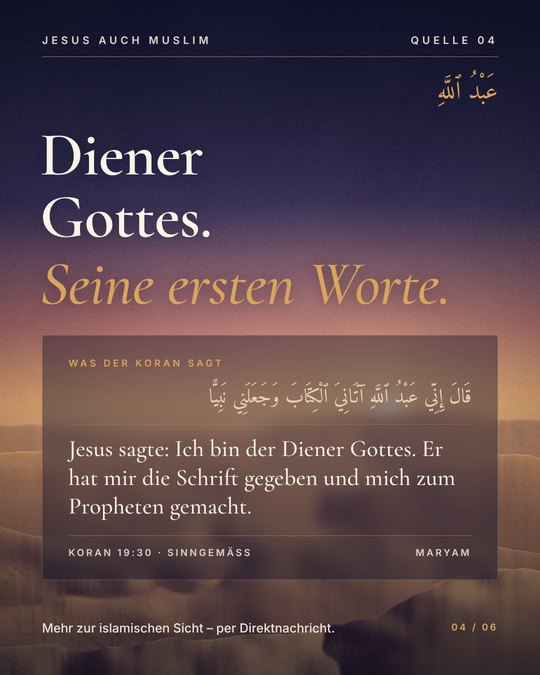
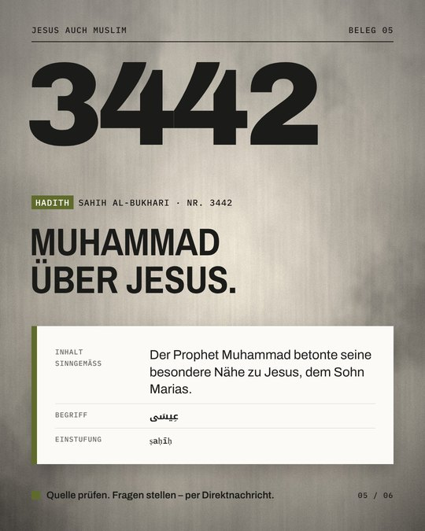

# Jesus auch Muslim – Post-Generator

Instagram-Posts (1080 × 1350 px) in drei Designs – erstellt über ein Formular auf GitHub. Claude prüft den Inhalt, die Vorlage gestaltet den Post, das Ergebnis erscheint als Kommentar.

<p>
  
  
  
</p>

## So erstellen Sie einen Post

1. **Issues → New issue → „Neuer Instagram-Post“** öffnen.
2. Design wählen, Quelle und Text eintragen, auf **Create** klicken.
3. Nach 1–2 Minuten erscheint der fertige Post als Kommentar, zusammen mit dem Prüfergebnis.
4. Ändern: Issue bearbeiten. Der Post wird automatisch neu erzeugt.

Bei *Titel*, *Titel-Akzent*, *Arabischer Schlüsselbegriff* und *Aufruf* kann `VORSCHLAG` eingetragen werden; Claude schlägt dann einen Text vor und kennzeichnet ihn im Kommentar.

## Was automatisch passiert

| Schritt | Wer | Was |
|---|---|---|
| Prüfen | Claude API | Ton, Quellenangabe, Plausibilität von Text und arabischem Vers, Längen; Ampel Grün/Gelb/Rot; Vorschläge nur für Felder mit `VORSCHLAG` |
| Gestalten | Vorlage + Playwright | Feste Positionen, Farben, Schriften; Text wird bei Bedarf in Grenzen verkleinert |
| Ablegen | GitHub Actions | PNG, `inhalt.json` und `bericht.md` unter `posts/<Issue-Nummer>/`, Kommentar im Issue, Download als Artefakt |

Claude verändert **nie** Quelle, deutschen Text, Texttyp oder arabischen Vers – es meldet nur Auffälligkeiten. Die fachliche Freigabe bleibt bei Menschen (Checkbox im Formular).

## Designs

| Design | Ordner | Hintergründe |
|---|---|---|
| D · Licht & Weite | `designs/licht-und-weite` | 6 Wüstenlandschaften |
| E · Muster & Maß | `designs/muster-und-mass` | Fliesen (Bogenrahmen), Gitterfenster, Sternrosette (Medaillon) |
| F · Quelle & Beleg | `designs/quelle-und-beleg` | Kalkstein, See (dunkel), Pergament |

„Automatisch“ wählt den Hintergrund nach Quellentyp. Neue Bilder in den jeweiligen Ordner `hintergruende/` legen und in `design.json` eintragen.

## Einrichtung (einmalig)

Das Skript `einrichten.sh` (Mac/Linux) bzw. `einrichten.ps1` (Windows) erledigt alles:
Repository anlegen, Label `post` erstellen und den Claude-API-Schlüssel als Secret `ANTHROPIC_API_KEY` speichern.

Von Hand: Repository hochladen → *Settings → Secrets and variables → Actions* → Secret `ANTHROPIC_API_KEY` anlegen.
Optional: Variable `CLAUDE_MODEL` (Standard: `claude-sonnet-5-5`).

## Lokal ausprobieren

```bash
pip install -r tools/requirements.txt
python -m playwright install chromium
python tools/post.py --json beispiele/beispiel.json --ausgabe ausgabe/test
```

Ohne `ANTHROPIC_API_KEY` wird der Post ohne KI-Prüfung erstellt.

## Sicherheit

- Der Workflow reagiert nur auf Issues von Personen mit Schreibrechten (Owner, Mitglieder, Collaborators). Fremde Issues lösen keine API-Kosten aus.
- Formularinhalte werden Claude als Daten übergeben, nicht als Anweisungen. Versucht jemand, Claude über das Formular Anweisungen zu geben, setzt Claude die Ampel auf Rot.

## Hinweise

- Die Hintergrundbilder sind computergenerierte Platzhalter.
- Schriften (Cormorant Garamond, Inter, Amiri, Marcellus, Reem Kufi, Archivo, IBM Plex Mono, Noto Kufi Arabic) stehen unter der SIL Open Font License und sind in die Vorlagen eingebettet.
